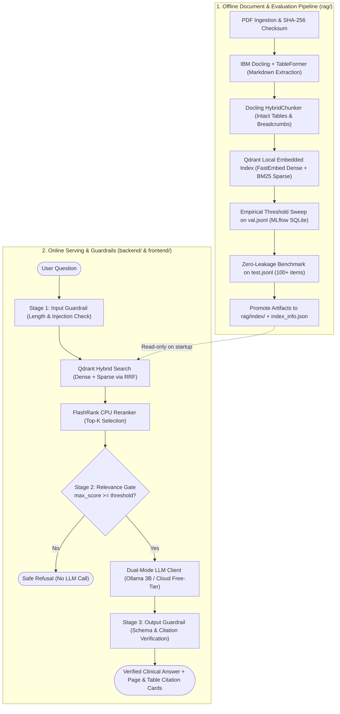

# Clincite

> **Ask. Cite. Verify.**  
> *Production clinical guideline RAG with table-intact Docling parsing, Qdrant hybrid search, calibrated guardrails, and verified citations.*

---

## 1. Overview & Problem Statement

Clinical practice guidelines—such as Indonesia's *Pedoman Nasional Pelayanan Kedokteran (PNPK Kemenkes RI)*—are information-dense documents featuring complex dosage adjustment tables, diagnostic thresholds, lab criteria, and multi-layered chapter hierarchies.

Conventional RAG pipelines often suffer from:
1. **Garbage-In Extraction:** Text-only PDF parsers destroy row-column alignments in drug titration and renal clearance tables.
2. **Vocabulary Mismatches:** Pure dense vector search frequently fails on exact drug names, units, and clinical abbreviations (*eGFR, HbA1c, GDP*).
3. **Hallucination in High-Stakes Queries:** Lack of an objective, empirically calibrated abstention gate causes LLMs to guess answers when context is missing.

**Clincite** solves this with an end-to-end clinical retrieval system engineered for CPU efficiency (100% runnable on local consumer laptops with zero mandatory API costs), strict citation fidelity, and verifiable guardrails.

---

## 2. Core Architecture

---

## 3. Project Roadmap & Progressive Architecture

To ensure strict modular isolation, the repository follows a **Progressive Directory Creation** lifecycle:

- [ ] **Phase 0 — Repository Foundation & Scaffold:** Git setup, strict gitignore, and foundational utilities (`rag/src/utils/`).
- [ ] **Phase 1 — Ingestion & Chunking:** IBM Docling extraction, TableFormer layout verification, and chunk EDA.
- [ ] **Phase 2 — Hybrid Retrieval & Eval Curation:** Qdrant embedded vector store, BM25 sparse search, FlashRank, and curation of `val.jsonl` / `test.jsonl`.
- [ ] **Phase 3 — Guardrails, MLflow Calibration & Evaluation:** 3-stage guardrails, dual-mode LLM adapter, MLflow parameter sweep, and index promotion (`v0.1.0-rag`).
- [ ] **Phase 4 — Stateless Backend API:** FastAPI read-only serving service and OpenAPI contract (`v0.2.0-backend`).
- [ ] **Phase 5 — Clinical Web UI:** React 19 + TypeScript + Tailwind CSS v4 interactive workspace.
- [ ] **Phase 6 — Docker, CI/CD & Portfolio Release:** Production containers, GitHub Actions CI, and live cloud deployment (`v1.0.0`).

---

## 4. Disclaimers

### Medical Disclaimer
> **Clincite is a clinical reference retrieval aid** based on indexed *Pedoman Nasional Pelayanan Kedokteran (PNPK)* documents. It is **not** a substitute for clinical judgment, medical consultation, diagnosis, or patient management by certified healthcare professionals. Always cross-verify critical dosages, contraindications, and laboratory cutoffs directly against the referenced official source guidelines.

### Non-Affiliation Notice
> **Clincite is an independent software engineering project** utilizing public Indonesian Ministry of Health (Kemenkes RI) clinical guidelines. It is not affiliated with, endorsed by, or operated by the Ministry of Health of the Republic of Indonesia.

---

## 5. License

This project is licensed under the [MIT License](LICENSE).

